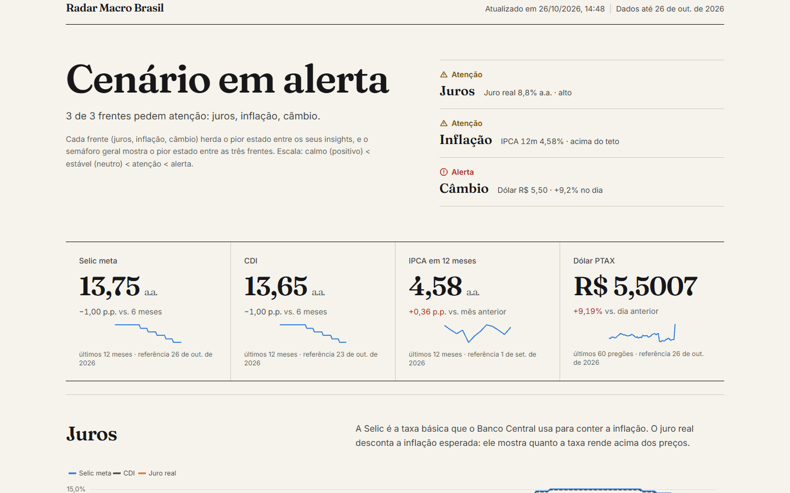
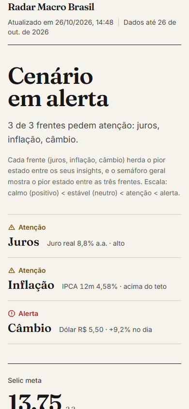
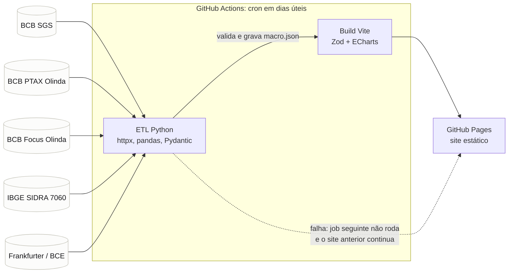

# Radar Macro Brasil

> Macro dashboard for Brazil: Selic, inflation, FX and market expectations from public BCB/IBGE data, with rule-based explanations.
> Python ETL validated by Pydantic, React + TypeScript front end validated by Zod, published daily to GitHub Pages.
> No API keys, no LLM, no server.

Painel macroeconômico do Brasil com dados públicos: juros, inflação, câmbio e expectativas de mercado, em leitura de
30 segundos, com cada conclusão explicada pela regra que a gerou.



<p>
  
</p>

## Por que importa

Números de juros e inflação aparecem em todo noticiário, mas quase sempre sem explicação do que significam para o
orçamento. O Radar mostra o cenário em um veredito, mostra a evidência de cada leitura e deixa claro o que é regra e o
que é opinião. Também é um exemplo de pipeline de dados de ponta a ponta: coleta agendada, validação de contrato,
publicação estática e visualização acessível.

## Funcionalidades

- **Semáforo macro** por frente (juros, inflação, câmbio), sempre com ícone e rótulo, nunca só cor.
- **Indicadores:** Selic meta, CDI, IPCA em 12 meses e dólar PTAX, com variação e sparkline.
- **Gráficos:** Selic, CDI e juro real; IPCA mensal e em 12 meses contra a meta; Focus com faixa de projeções; PTAX
  com média móvel e banda; IPCA por grupo.
- **Leituras:** cada insight traz o que significa, uma orientação prática, a evidência e a regra usada.
- **Simulador de renda fixa:** poupança, CDB com IR regressivo e LCI/LCA, com valor de hoje descontada a inflação.
- **Acessível:** tabela alternativa para cada gráfico, rótulos, foco visível e `prefers-reduced-motion`.

## Arquitetura



- `etl/`: coleta, transformação, insights por regras, checagens de qualidade e contrato Pydantic. Veja
  [etl/README.md](etl/README.md).
- `src/`: front React + TypeScript (strict). Valida o JSON com Zod por seção: uma seção inválida não derruba a página.
- `schema/macro.schema.json`: JSON Schema gerado pelo ETL; um teste garante que não está desatualizado.
- `public/data/macro.json`: último snapshot usado para desenvolvimento local.

## Fontes de dados

| Fonte | O que usamos | Chave | Atribuição |
|---|---|---|---|
| [BCB · SGS](https://api.bcb.gov.br/dados/serie/) | Selic meta, CDI, IPCA mensal | Não | Banco Central do Brasil |
| [BCB · PTAX (Olinda)](https://olinda.bcb.gov.br/olinda/servico/PTAX/versao/v1/aplicacao#!/recursos) | Dólar PTAX de venda | Não | Banco Central do Brasil |
| [BCB · Focus (Olinda)](https://olinda.bcb.gov.br/olinda/servico/Expectativas/versao/v1/aplicacao#!/recursos) | Medianas, mínimas e máximas de IPCA e Selic | Não | Banco Central do Brasil |
| [IBGE · SIDRA, agregado 7060](https://servicodados.ibge.gov.br/api/docs/agregados?versao=3) | IPCA por grupo | Não | IBGE |
| [Frankfurter](https://frankfurter.dev/) | Conferência independente do dólar (câmbio de referência do BCE) | Não | Dados do BCE via Frankfurter |

Todas as fontes são públicas e sem chave. Os limites de uso não são documentados de forma detalhada pelas APIs; o ETL
faz poucas chamadas por execução, com User-Agent descritivo e retry com backoff. Confira os termos de cada fonte antes
de reutilizar os dados.

## Como rodar

Pré-requisitos: Node 24 (`.nvmrc`), npm, Python 3.12+ e [uv](https://docs.astral.sh/uv/).

```bash
# front-end
npm ci
npm run dev            # desenvolvimento
npm run build          # produção (gera dist/ com CSP)
npm run preview        # http://127.0.0.1:4171

# ETL (gera public/data/macro.json e schema/macro.schema.json; faz chamadas de rede)
cd etl && uv sync && uv run radar-etl run

# checagens
npm run lint && npm run typecheck && npm test
cd etl && uv run ruff check && uv run pytest
```

## Decisões de segurança

- **CSP** por `<meta>` no build de produção, com `connect-src 'self'`: o site não chama APIs em runtime.
- **Sem segredos e sem chaves** no repositório ou no front-end.
- **Sem `dangerouslySetInnerHTML`.** Textos vindos do JSON são renderizados como texto.
- **Permissões mínimas** nos workflows (`contents: read` por padrão).
- **Dependabot** para npm, uv e GitHub Actions.
- Detalhes e alternativas descartadas em [docs/design.md](docs/design.md).

## Limitações conhecidas

- O simulador não modela TR, IOF, taxas, come-cotas nem a inflação pessoal de quem usa.
- `frame-ancestors` (proteção contra clickjacking) não se aplica: só funciona como header HTTP, e o GitHub Pages não
  permite configurar headers.
- O IPCA por grupo tem a defasagem de divulgação do IBGE.
- O bundle de JavaScript tem cerca de 900 kB sem compressão, quase todo do ECharts.
- Não há testes end-to-end automatizados; a verificação visual foi feita com capturas manuais.

## Roadmap

- Carregar gráficos e simulador sob demanda para reduzir o bundle inicial.
- Incluir a TR no simulador da poupança.
- Testes end-to-end com Playwright, incluindo a checagem de CSP.

## Licença

MIT. Copyright (c) 2026 Herick Silva. Veja [LICENSE](LICENSE).
